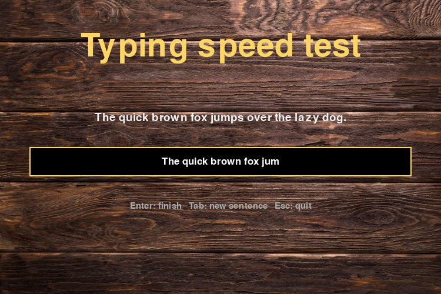
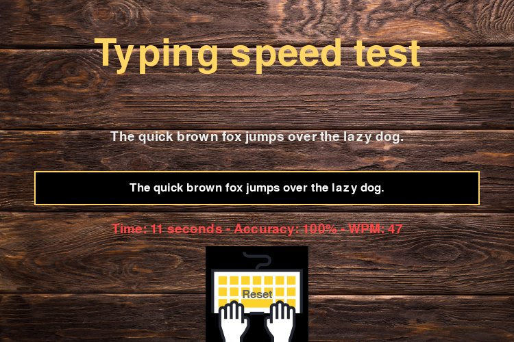

# tsg

[](https://github.com/UltiRequiem/tsg/actions/workflows/ci.yaml)
[](https://pypi.org/project/tsg/)
[](https://pypi.org/project/tsg/)
[](./license)

A typing speed game for your desktop. Type the sentence, press Enter, get your time, accuracy and
words per minute. Written with [pygame](https://www.pygame.org).



## Install and play

```sh
pip install tsg
tsg
```

Or without installing it permanently:

```sh
uvx tsg      # or: pipx run tsg
```

Needs Python 3.10 to 3.13 (pygame has no Python 3.14 build yet) and a desktop session, since it opens a window.

## How to play

1. A sentence appears. **Start typing**, or click the box. The clock starts on your first key.
2. Press **Enter** when you are done. Your result appears.
3. Click **Reset** to get a new sentence.

| Key | Does |
|---|---|
| any printable key | types (starts the clock on the first one) |
| Backspace | deletes the last character |
| Enter | finishes and scores the round |
| Tab | skips to a new sentence at any time |
| Esc | quits |



### How it is scored

- **WPM** is *gross* words per minute: characters typed ÷ 5 ÷ minutes, mistakes included. A "word" is five characters.
- **Accuracy** compares each position with the sentence. Wrong, missing and extra characters all count against
  you: correct characters ÷ the longer of the sentence and what you typed.
- **Time** runs from your first keystroke to Enter.

## Use your own sentences

```sh
tsg --sentences my-sentences.txt
```

The file is either plain text with one sentence per line, or a `.json` list of strings. Keep sentences under
about 65 characters so they fit the window. Other options: `tsg --help`, `tsg --version`.

## Troubleshooting

- **`ModuleNotFoundError` or no pygame wheel:** use Python 3.10 to 3.13.
- **No window / `video system not initialized`:** you are on a machine without a display (SSH, a container). Run it on your desktop.
- **Linux:** if pygame complains about a missing driver, install your distribution's SDL2 packages.

## Development

```sh
uv sync
uv run pytest      # the tests run the real window with SDL's dummy drivers, no display needed
uv run ruff check . && uv run ruff format --check .
```

The game logic is in `tsg/core.py` (no pygame, easy to test) and the window is in `tsg/game.py`.

## License

MIT, see [license](./license).
